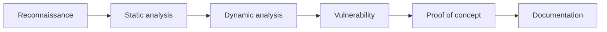

<div align="center">

# 🌧️ RainFall

### Binary exploitation · Reverse engineering · x86-64 security

[](https://42.fr/)


*Breaking vulnerable programs to understand how to build safer ones.*

<br>


</div>

---

## About the project

**RainFall** is an offensive security project from the 42 curriculum. It places the student inside a dedicated Linux virtual machine containing a chain of deliberately vulnerable x86-64 ELF programs. The goal is to understand exactly how each program handles data and privileges, then turn one implementation flaw into controlled execution.

Each challenge runs under a restricted `levelXX` account. Its target binary has the **SUID** permission and belongs to a more privileged `flagXX` account. A successful exploit makes the vulnerable program perform an action with its owner's privileges, allowing the next credential to be recovered and the following level to be unlocked.

This creates a complete security-audit loop: inspect an unknown binary, reconstruct its behaviour, identify the trust boundary it violates, build a reliable proof of concept and explain why it works. Progress depends on understanding the vulnerability—not on guessing or brute force.

> All exercises are performed inside an isolated and authorised virtual machine designed for educational purposes.

## At a glance

| | |
| --- | --- |
| **Objective** | Identify and exploit vulnerabilities in ELF binaries |
| **Architecture** | x86-64 on Linux |
| **Scope** | 11 mandatory levels and 5 optional challenges |
| **Approach** | Static analysis, dynamic debugging and exploit development |
| **Environment** | Linux, SSH and VirtualBox |
| **Key outcome** | A repeatable security analysis methodology |

## Progress

| Level | Status | Main technique | Documentation |
| --- | --- | --- | --- |
| `level00` | Completed | Stack buffer overflow and injected shellcode | [Walkthrough](level00/resources/walkthrough.md) |
| `level01` | Completed | Stack buffer overflow and ret2win-style control-flow hijacking | [Walkthrough](level01/resources/walkthrough.md) |
| `level02`–`level10` | Not documented yet | — | — |

## How the project works

```text
SSH into level00
       │
       ▼
Inspect the level's SUID binary
       │
       ▼
Reverse its logic and memory layout
       │
       ▼
Identify a controllable vulnerability
       │
       ▼
Build and validate an exploit
       │
       ▼
Execute in the flagXX security context
       │
       ▼
Recover the next SSH credential ──────► Repeat through level10
```

The progression is intentionally cumulative. Early levels teach how user-controlled input reaches memory; later levels require several observations and exploitation primitives to be combined while protections are active.

For every stage, the result must be reproducible and defensible during a peer evaluation. It is not enough for a payload to work: every offset, address, register transition and side effect must be understood.

## What this project demonstrates

- Reverse engineering unfamiliar binaries, with or without source code
- Reading assembly and understanding process memory
- Finding vulnerabilities and measuring their real impact
- Building minimal, reliable and reproducible proofs of concept
- Adapting an exploit to modern binary protections
- Documenting and presenting a complex technical investigation
- Working autonomously while collaborating effectively when needed

## Technical scope

The mandatory path contains **11 levels, from `level00` to `level10`**. Five harder bonus challenges extend the project with additional heap and mitigation-bypass techniques.

The challenges cover a broad range of binary exploitation concepts:

```text
Memory corruption          Stack overflows · Off-by-one errors · Heap corruption
Control-flow hijacking     Return address overwrite · Stack pivoting
Code reuse                 ret2libc · Return-Oriented Programming
Data manipulation          Format-string leaks and writes · Integer overflows
Runtime analysis           Address leaks · Offset calculation · Calling conventions
Mitigation bypasses        NX · Stack canaries · ASLR · RELRO · PIE
```

### Increasing difficulty

| Stage | Main learning objective |
| --- | --- |
| Foundations | Recognise unsafe input handling and understand stack layout |
| Exploitation primitives | Turn memory corruption or uncontrolled formatting into useful reads, writes or control-flow changes |
| Code reuse | Redirect execution through existing functions or instruction sequences when injected code cannot run |
| Runtime uncertainty | Leak addresses and calculate targets dynamically instead of relying on fixed locations |
| Final challenge | Chain several primitives while NX, stack canaries and ASLR are enabled together |
| Bonus path | Explore heap corruption, use-after-free, PIE bypasses and dynamic-resolver abuse |

The final mandatory challenge cannot be solved with a single weakness. It requires leaking runtime information, defeating the canary and rebuilding a libc-relative ROP chain before control of execution can be obtained.

## Analysis workflow

Every binary is approached through the same evidence-based process:



1. **Reconnaissance** — identify the file format, architecture, symbols and active protections.
2. **Static analysis** — disassemble the binary and reconstruct its intended logic.
3. **Dynamic analysis** — inspect registers, stack, heap and execution flow at runtime.
4. **Vulnerability assessment** — validate the available primitive and its constraints.
5. **Exploitation** — create the smallest reliable proof of concept.
6. **Documentation** — explain the root cause, exploitation strategy and possible remediation.

## Tools and technologies

| Area | Tools and concepts |
| --- | --- |
| Static analysis | `objdump`, `readelf`, `nm`, x86-64 assembly |
| Dynamic analysis | `gdb`, breakpoints, registers and memory inspection |
| Binary security | `checksec`, ELF, SUID and calling conventions |
| Exploitation | ROP, `ret2libc`, format strings and memory corruption |
| Automation | Shell scripting and payload generation |
| Infrastructure | Linux, SSH and VirtualBox |

## Repository layout

```text
ft_rainfall/
├── assets/                     # Static project files
│   ├── rainfall-demo.gif       # README illustration
│   ├── rainfall-ova-url.txt    # Official appliance URL
│   ├── subject.pdf             # Original project subject
│   └── scripts/
│       └── rainfall-vm         # VirtualBox and SSH helper
└── levelXX/
    ├── flag                    # Credential, once the level is solved
    └── resources/
        ├── program/            # Files copied from the appliance
        │   ├── challenge       # Original ELF binary
        │   └── challenge.c     # Matching C source
        ├── walkthrough.md      # Reproducible analysis
        └── poc.py              # Proof of concept or exploit
```

Each level is self-contained. Static files and project tooling are grouped in
`assets/`. The original subject is available [here](assets/subject.pdf).

## Local VM helper

The repository includes a small, sudo-free VirtualBox CLI for managing the
official RainFall appliance. The OVA and all VirtualBox disks stay outside the
repository and are ignored by Git.

```bash
# Check the local environment
./assets/scripts/rainfall-vm doctor

# Download, import and configure the official appliance
./assets/scripts/rainfall-vm setup

# Start headless and choose a level (its password is read locally)
./assets/scripts/rainfall-vm start
./assets/scripts/rainfall-vm ssh

# Or select it directly; level01 uses level00/flag
./assets/scripts/rainfall-vm ssh level01
./assets/scripts/rainfall-vm ssh --level 02

# The level00 VM share is mounted automatically on the host
cd shared

# Inspect or stop the VM
./assets/scripts/rainfall-vm status
./assets/scripts/rainfall-vm stop
```

The guest still listens on port `4242`, forwarded locally to `127.0.0.1:4243`.
With no argument, `rainfall-vm ssh` interactively proposes every level whose
credential is available. To enter `levelXX`, the helper automatically reads
`level(X-1)/flag`; `level00` uses the initial `level00` password. Credentials
are supplied through a private temporary SSH askpass helper and are never put
on the command line. The first login key is already installed, so `ssh
rainfall` also connects directly to `level00`. Run
`./assets/scripts/rainfall-vm help` for every command and override.

The appliance URL is read from `assets/rainfall-ova-url.txt`. A different file
can be selected with `RAINFALL_OVA_URL_FILE=/path/to/url.txt`.

The workstation also has `pwndbg` with an Intel/Dracula configuration,
Binary Ninja Free 6.0, and Ghidra 12.2 with a private JDK 25 runtime. Launch
them with `gdb`, `binaryninja`, and `ghidra`; no sudo installation is needed.
The appliance itself already provides pwndbg under `/opt/pwndbg`, and the
`level00` GDB configuration uses the same Dracula theme.

## Deliverables

The project specification requires each solved level to be documented independently so that the reasoning remains easy to review and present:

```text
levelXX/
├── flag                         # Added after solving the level
└── resources/
    ├── program/
    │   ├── challenge            # ELF copied from the VM
    │   └── challenge.c          # Corresponding source
    ├── walkthrough.md           # Analysis and reproduction steps
    ├── poc.py                   # Exploit or proof of concept
    └── supporting files when needed
```

The `flag` file records proof of progression and is added only when the level
has been solved. A level currently under investigation may therefore contain
only `resources/`. The `program/` directory preserves the challenge binary and
its matching C source as copied from the authorised appliance; their original
names, such as `case` or `ono`, are kept. The rest of `resources/` contains the
analysis, payload-generation scripts and supporting files needed to reproduce
the solution.

This separation keeps the repository focused on the **reasoning and reproducibility** of the work rather than distributing the challenge binaries themselves.

## Professional takeaways

RainFall strengthened skills that apply well beyond penetration testing:

- debugging low-level and difficult-to-reproduce behaviour;
- distinguishing verified facts from assumptions;
- tracing a security issue from root cause to practical impact;
- communicating technical risks to different audiences;
- applying secure-development principles during implementation and code review.

## Ethical use

The techniques covered here must only be used against systems for which explicit authorisation has been granted. This repository documents work carried out on intentionally vulnerable programs in a controlled educational environment.

---

<div align="center">

**42 curriculum · Offensive security · Binary exploitation**

[Explore my other projects](https://github.com/Zibgame)

</div>
