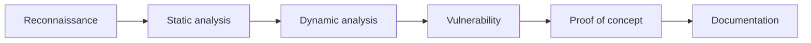

<div align="center">

# 🌧️ RainFall

### Binary exploitation · Reverse engineering · x86-64 security

[](https://42.fr/)


*Breaking vulnerable programs to understand how to build safer ones.*

</div>

---

## About the project

**RainFall** is an offensive security project from the 42 curriculum. It consists of auditing a series of deliberately vulnerable x86-64 ELF binaries, understanding their behaviour and exploiting each flaw to progress through **11 increasingly difficult levels**.

The project goes beyond writing exploits: it develops the ability to investigate unfamiliar software, reason from low-level evidence and clearly explain complex technical findings.

> All exercises are performed inside an isolated and authorised virtual machine designed for educational purposes.

## At a glance

| | |
| --- | --- |
| **Objective** | Identify and exploit vulnerabilities in ELF binaries |
| **Architecture** | x86-64 on Linux |
| **Scope** | 11 mandatory levels and 5 optional challenges |
| **Approach** | Static analysis, dynamic debugging and exploit development |
| **Environment** | Linux, SSH and VirtualBox |
| **Key outcome** | A repeatable security analysis methodology |

## What this project demonstrates

- Reverse engineering unfamiliar binaries, with or without source code
- Reading assembly and understanding process memory
- Finding vulnerabilities and measuring their real impact
- Building minimal, reliable and reproducible proofs of concept
- Adapting an exploit to modern binary protections
- Documenting and presenting a complex technical investigation
- Working autonomously while collaborating effectively when needed

## Technical scope

The challenges cover a broad range of binary exploitation concepts:

```text
Memory corruption          Stack overflows · Off-by-one errors · Heap corruption
Control-flow hijacking     Return address overwrite · Stack pivoting
Code reuse                 ret2libc · Return-Oriented Programming
Data manipulation          Format-string leaks and writes · Integer overflows
Runtime analysis           Address leaks · Offset calculation · Calling conventions
Mitigation bypasses        NX · Stack canaries · ASLR · RELRO · PIE
```

The final mandatory challenge combines several mitigations at once. Solving it requires chaining multiple primitives: leaking runtime data, preserving the stack canary and rebuilding a libc-relative ROP chain before taking control of the execution flow.

## Analysis workflow

Every binary is approached through the same evidence-based process:



1. **Reconnaissance** — identify the file format, architecture, symbols and active protections.
2. **Static analysis** — disassemble the binary and reconstruct its intended logic.
3. **Dynamic analysis** — inspect registers, stack, heap and execution flow at runtime.
4. **Vulnerability assessment** — validate the available primitive and its constraints.
5. **Exploitation** — create the smallest reliable proof of concept.
6. **Documentation** — explain the root cause, exploitation strategy and possible remediation.

## Tools and technologies

| Area | Tools and concepts |
| --- | --- |
| Static analysis | `objdump`, `readelf`, `nm`, x86-64 assembly |
| Dynamic analysis | `gdb`, breakpoints, registers and memory inspection |
| Binary security | `checksec`, ELF, SUID and calling conventions |
| Exploitation | ROP, `ret2libc`, format strings and memory corruption |
| Automation | Shell scripting and payload generation |
| Infrastructure | Linux, SSH and VirtualBox |

## Deliverables

Each level is documented independently so that the reasoning remains easy to review and present:

```text
levelXX/
├── flag
└── resources/
    ├── walkthrough.md
    └── scripts and supporting material
```

Vulnerable binaries are intentionally excluded from the repository. They are inspected exclusively inside the virtual machine supplied with the project.

## Professional takeaways

RainFall strengthened skills that apply well beyond penetration testing:

- debugging low-level and difficult-to-reproduce behaviour;
- distinguishing verified facts from assumptions;
- tracing a security issue from root cause to practical impact;
- communicating technical risks to different audiences;
- applying secure-development principles during implementation and code review.

## Ethical use

The techniques covered here must only be used against systems for which explicit authorisation has been granted. This repository documents work carried out on intentionally vulnerable programs in a controlled educational environment.

---

<div align="center">

**42 curriculum · Offensive security · Binary exploitation**

[Explore my other projects](https://github.com/Zibgame)

</div>
